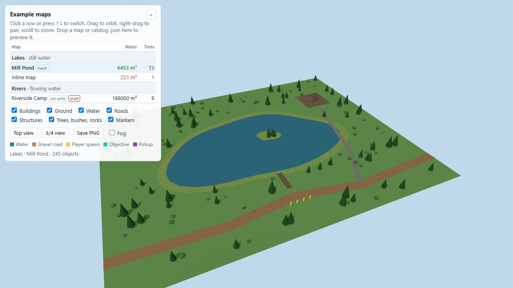

# topdown-map-viewer: refreshed imagery

New concept branding and a fresh interface capture or data view, prepared October 29, 2026.

Fresh browser capture of current viewer and bundled Mill Pond catalog entry, all layers enabled.

The banner is AI-generated symbolic brand artwork, not a product screenshot or a promise of output quality. The original generated PNG is preserved. [Exact prompt](PROMPT.txt) · [Source revision, input and output fingerprints](provenance.json).

